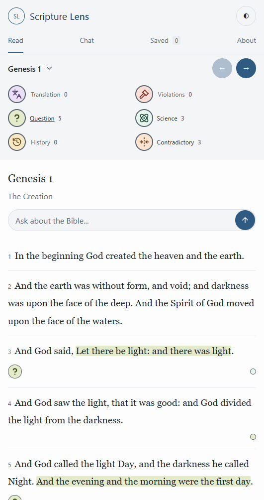
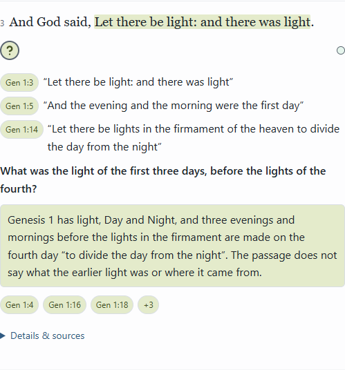
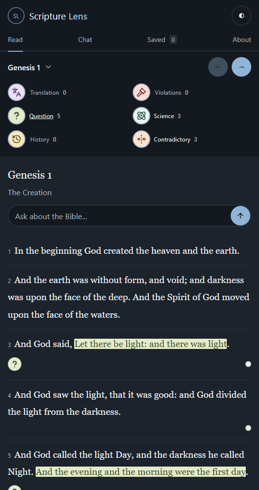

# Icon and citation refinements — 2026-10-13

Applied the owner's ten browser comments. The latest Science label supersedes the earlier Unscientific comment. Visible legend labels are Translation, Violations, Question, Science, History and Contradictory. Stored category values and record meanings are unchanged.

Question now uses the existing Lucide question-mark strokes with the surrounding SVG circle removed, enlarged for legibility. It is a plain question mark within the category button, not a second encircled icon. No new path geometry or icon set was introduced. Citation chips contain reference text only, without category SVGs or separate icon badges. Each chip, including its additional-citation control, uses its record category's pastel fill and ink. Full-verse hover previews, direct navigation and T witness metadata remain intact.

Filter icon circles and verse buttons have a 1px border using --muted, the chapter-subtitle text color, and a 2px border when selected. Fixed outer dimensions prevent layout shifts. Keyboard focus remains visible. Context markers on the right shrink from 16px to 12px, remain symbol-free, and retain enlarged hit areas and accessible names/tooltips.

| Category | Fill | Ink | Light/dark contrast |
|---|---|---|---:|
| Translation | #ebe0f5 | #50356c | 7.99:1 |
| Violations | #f9ded8 | #792b22 | 7.55:1 |
| Question | #e4ebcb | #435023 | 7.07:1 |
| Science | #e6f5ed | #234c3b | 8.60:1 |
| History | #f8e8c3 | #624514 | 7.28:1 |
| Contradictory | #fbe4d2 | #713c19 | 7.25:1 |

Six unique pastel fills. Q and V preserve their previous exact colors. All icon and citation text contrasts exceed 4.5:1 in both themes. Page palette, red-letter colors, data, content, Chat engine and research/claude-drafts/ are unchanged.

Build and all npm checks pass. Actual built Worker checked in headless Microsoft Edge at 375px, 531px and 1280px, light and dark. Browser assertions cover visible labels, six unique fills, border color and 1px/2px state changes, absence of the Q SVG circle, compact icon-free citation height and color, full-verse hover preview, 12px context-marker click behavior, keyboard filtering, no horizontal overflow, and preserved T witness lead-ins. Adjacent browser-checks.json records rendered colors and checks. Existing test assertions now check citation tone and witness metadata instead of removed icon markup.

