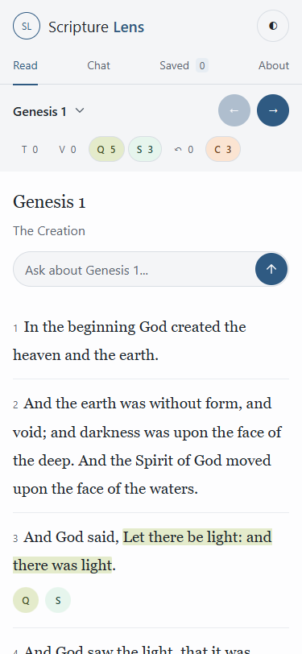
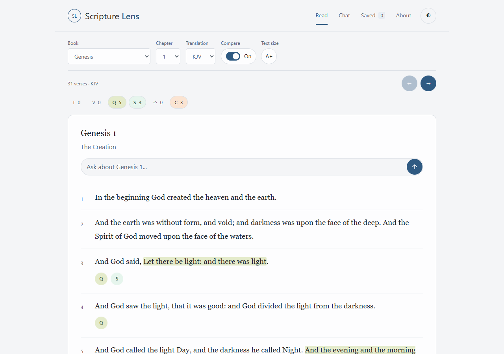
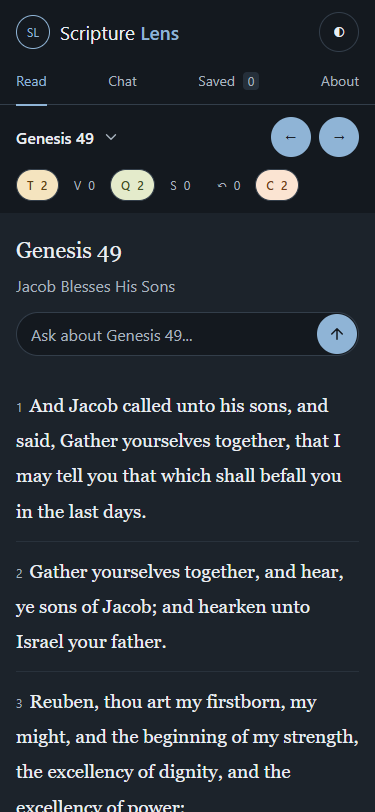
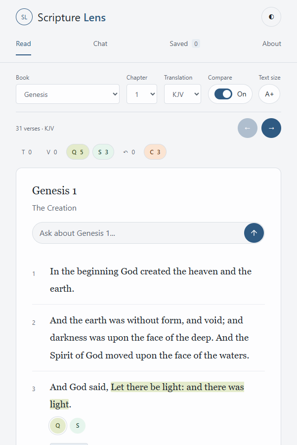

# Reader design cleanup — 2026-10-13

Owner requested a visual cleanup after the UI refresh. Reduced desktop reading width to a centered 1000px shell, aligned verse numbers with their first text line, softened verse separators, and standardized chapter-header and annotation spacing. Combined the mobile chapter picker and navigation into one row, removed duplicate visible chapter metadata, and used a clear SVG chevron. Empty category filters now use muted text without a colored fill; actual verse chips retain their colors and category meanings. Supporting-context titles wrap rather than truncate.

The settings sheet has consistent spacing and a neutral backdrop. Browser zoom is enabled. Category filters restore keyboard focus after rerendering. Fixed the 601–650px header overlap caused by wrapped navigation inside a fixed-height header. Chapter question entry remains one full-width 44px line with a 40px send button.

No changes to palette variables, red-letter colors, annotation data, chapter names, witness labels or Chat logic. No Claude drafts edited. Source changes are confined to style.css, index.html and the UI metadata/filter-focus lines in reader.js, plus the built output and this verification record.

## Checks

- npm run check and npm run build passed, including the existing 18 fixture-based Chat reliability cases.
- Actual built Worker checked in headless Microsoft Edge: Genesis 1 and 49 at 375×812 and 1280×900, light and dark. First verse remains fully visible on phones, ending at 470.45px and 540.73px respectively, about 58px higher than before.
- Browser checks passed for modal controls, Compare, A+, category filters, individual summary toggles, type-size minimums and 44px composer geometry.
- Additional expanded-summary checks at 320, 600, 601, 768 and 1280px: no horizontal overflow or header overlap; filter focus retained; Space toggles the filter; Q summary opens.
- Known contrast exceptions from the prior report remain: exact light primary on page background 6.63:1 versus a 7:1 target; unchanged dark red letters on pale targeted highlights 1.69–1.91:1. Disabled filters now use muted theme text, which passes 4.5:1.

Screenshots and machine-readable results are in [ui-cleanup-2026-10-13](ui-cleanup-2026-10-13/).

## Representative views

