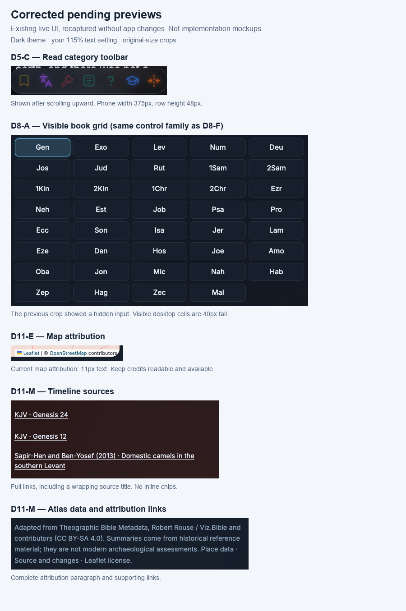

# BibleLens UI review — final owner decisions

**TL;DR:** D1–D17 now capture your choices: compact controls, quieter reading, consistent cards and panels, iPhone-like Chat bubbles, and adjustable plain-surface opacity. All D1–D17 design choices and the D2 replacement mapping are approved. D5-C and D11-E/M are approved; D8-A is approved to merge, with the option to revert. No design selections remain open; practical implementation details are listed below. **No app files changed, and implementation remains on hold.**

This is the current decision summary. Later instructions supersede earlier suggestions; historical discussions remain in live-walkthrough.md. The rejected liquid-glass previews and intermediate opacity values are not implementation instructions. All appearance choices are reversible.

## Decisions

| Decision | Final owner choice |
|---|---|
| **D1 — Summaries** | E-style main-summary structure, including biographies; match D to E; retain B for Chat and C for section introductions. Surface effects follow D17, replacing earlier glass wording. |
| **D2 — Passage/citation controls** | Keep C/D/F/H/J. C/F/H form one small citation family. Approved mapping: A/B/E/G/I → J-style standalone controls; K → D-style text link. Preserve D3-F prophecy pairing and all destinations/preview behavior. All inline instances follow D7. |
| **D3 — Expanded references** | E for quotations; A for reference lists; F for paired passages; C/D for comparisons; B for short commentary. Replace G's beside-quote layout with E in the proposed mapping. |
| **D4 — Search** | C's pill with magnifier for list searches; E's question composer and send action for Chat. Recommended common 48px field height and 16px default text were included in the accepted suggestion; phone wrapping still needs preview. |
| **D5 — Quick filters** | Compact pills with less padding, replacing the original 48px visible sizing. Meaningful colors; brighter selected color, no checkboxes. 44px phone tap areas. C's corrected toolbar layout is approved to keep. |
| **D6 — Panel filters** | Compact pills, less padding; preserve grids, icons and meaningful colors; 44px phone tap areas. Follow D5's brighter selected colors. |
| **D7 — Related navigation** | Compact standalone navigation controls; preserve destination icons, linked-story details, All-passages arrow and family-row layout. Clear name links; quieter noninteractive labels. Within sentences use colored text links, never chips. Inline pins no larger than text; omit if they cannot be reduced. |
| **D8 — Pickers** | H-style dropdowns; consistent compact grids; compact step pills; heading with dropdown cue; 44px phone tap areas. A is approved to merge with F's visible grid family; owner may revert this merge. |
| **D9 — Tabs/switches/slider** | Keep switch with On/Off text and slider with percentage; matching compact 14px tabs and brighter selection; clear mode label. F uses 20px icons outside verse text, with brighter active states and 44px phone tap areas. “A's 20px” referred to Option A in the supplemental size comparison, not D9-A's switch. |
| **D10 — Expand/inspect** | Consistent label-and-chevron rows; small in-card chevrons; clear Sources controls; matching compact History controls; one activation; 44px phone tap areas. Exception: Commandment cards now show all their information directly under D15. |
| **D11 — Actions** | Brighter main actions; compact secondary pills; text-only reset/reference links; clear feedback; 44px phone tap areas. Bookmark uses ribbon; Copy link uses two linked chain links. Corrected E/M previews are approved to keep. |
| **D12 — Icons/navigation** | Quiet 20px icons; matching close buttons; 48px floating buttons with 24px icons; preserve navigation/map layouts; 44px phone tap areas. W's copy action uses overlapping papers, distinct from D11's Copy link icon. |
| **D13 — Editors** | E-style editors and matching title fields; 12px corners; modest padding; readable text, clear focus; native file chooser. Preserve note contents and existing save behavior. |
| **D14 — Panels** | Calm shared surfaces; 24px corners; centered desktop panels and phone bottom sheets; compact 18px verse preview; modest spacing/reachable actions. Map: English, closer default zoom, taller. Note editor L uses sans serif. |
| **D15 — Cards** | J-based cards; 22px corners; modest padding; retain category colors/layouts; quieter inner sections; retain map frame; sans serif headings, explicitly including E. Plain surfaces follow D17; Chat and Commandment overrides are listed below. |
| **D16 — Focus** | Consistent blue focus ring: 2px thick with 2px gap; theme-adjusted contrast; whole-field focus; distinct from selection. Keyboard-visible focus; text fields remain visibly focused while typing. |
| **D17 — Opacity and gradient: approved** | Two Settings sliders, five discrete steps each: 0%, 5%, 10%, 15%, 20%. Base-opacity default 10%; gradient-strength default 15%. No displayed numbers, numbered ticks or combined-opacity text. One icon-only reset at the right of the Base opacity heading restores both defaults. Keep accessible labels and values, fully opaque text and meaningful category colors. Plain surfaces; no added glass blur, glow, refraction, grain or bevels. Approved preview saved as D17-approved-preview.html. |

## Later changes that take precedence

- **Compact sizing:** D5 and D6 use less visible padding, replacing the initial 48px visible-button proposal. Interactive phone tap areas remain at least 44px, with no overlap or interference with prose selection.
- **Within sentences:** colored text links only—no chips or buttons. Inline pins must be no larger than surrounding text; remove them if they cannot be sized appropriately. Standalone controls retain the selected chip treatments.
- **Selected states:** brighter meaningful colors, without checkboxes/checkmarks added as filter indicators. Keyboard focus remains distinct.
- **Chat:** iPhone-like bubbles with bottom-right cleft/tail for the owner and bottom-left for BibleLens; remove visible “You”/“BibleLens” names while preserving accessible speaker identification. Three-dot typing indicator while thinking, stopping on completion/error. This replaces the earlier existing-bubble recommendation.
- **Commandment cards:** show all card information directly, without expanding/collapsing those contents. D10 disclosure rules continue elsewhere.
- **Verse quotations:** italicize cited verse wording, not reference labels or commentary. Do not automatically italicize the main reading text.
- **Typography:** sans serif card headings throughout, explicitly including D15-E; sans serif text in D14-L's note editor.
- **Icons:** ribbon for Bookmark; two chain links for Copy link; overlapping papers for D12-W's Copy text action. These are separate actions.
- **Academic label:** remove “(History)” from the affected Academic button. Do not automatically rename every unrelated History disclosure.
- **Maps:** English labels, closer default zoom and taller map surface; no modern streets, elevations or terrain. Preserve map frame, required attribution, source details and uncertainty. Do not invent historical geography.
- **Surface appearance:** approved D17 supersedes “glass” in earlier D1/D15 choices. Retain their shapes, structure and category colors, using plain tinted surfaces controlled by base opacity and gradient strength. Do not revive Off/Subtle/Liquid presets or the rejected glass effects. Text stays fully opaque.

## D17 — approved preview

The owner approved the last preview with: “Looks good. Save this as D17 and update the final decision summary with all my changes. Show me anything still undecided.”

- Base opacity: 0–20%, default 10%.
- Gradient strength: 0–20%, default 15%.
- Both sliders have five internal steps, without visible numbers.
- Icon-only reset, aligned right beside Base opacity, restores both defaults. No visible reset label; accessible name retained.
- No combined-opacity readout.
- Use the actual Story tint RGB(99,102,241) as the comparison baseline; other categories retain their meaningful colors. The fixed reference represents the unchanged app's 10% base / 18% gradient; the adjustable sample starts at the approved 10% / 15% defaults.
- Preview: [approved D17 snapshot](D17-approved-preview.html). Editable preview: surface-opacity-preview.html. The preview demonstrates color/opacity without the rejected glass effects; it is not a screenshot of an implemented setting.
- The maxima cap each layer independently, not the combined composite. This is retained as technical information, not displayed in Settings.

## Approved D2 replacement mapping

The owner approved: **D5-C keep; D8-A merge, with the option to revert; D11-E/M keep.** Their corrected screenshots remain below as accepted reference evidence. Preserve D8-A/F's distinct source roles so any later reversal can be made without removing data or changing unrelated pickers.

The owner approved the [D2 replacement mapping](D2-replacement-mapping.md) with “D2 mapping approve”:

| Existing | Approved replacement |
|---|---|
| A — profile key verses | J-style standalone reference controls |
| B — directory passages | J-style standalone passage controls |
| E — Commandment passage | J-style standalone passage control |
| G — prophecy nodes | J-style controls, preserving D3-F's paired layout |
| I — Story main passage | J-style control with full range and useful navigation cue |
| K — Timeline passage | D-style colored text link |

Keep C/F/H as one small standalone evidence-citation family; keep J for supporting citations; use D-style colored links inside sentences everywhere. Preserve current destinations/preview behavior; all changes remain appearance choices. See the mapping document for benefits, risks and scope. This approves the design mapping; app implementation has not been authorized.

The corrected images are existing dark-theme captures at the preserved 115% text setting. D5-C is a 375px phone capture; other contexts and measured dimensions are in corrected-preview-measurements.json. D8-A's visible desktop cells are about 124×40px, while the chosen phone tap area is at least 44px. D11-E's existing attribution text is 11px, a documented readability concern. Earlier crops are superseded by these corrected examples.

## Still unresolved: implementation details and verification

- Find a feasible simplified map source without modern streets/terrain, with suitable English labels and required attribution. The current raster street tiles cannot be cleaned through CSS. No paid provider or signup is authorized.
- Exact Chat bubble tails, typing-dot appearance/timing, compact padding, map height and default zoom have no finalized numeric specification. These can follow the approved direction, but still need visual verification on phones; confirm note actions remain reachable above the keyboard. These are implementation details, not missing D1–D17 style selections.
- Check text contrast, keyboard focus and non-overlapping tap areas in both themes at 1280px and 375px. Do not claim the future design is validated by current-UI screenshots.
- Preserve existing note data, save/sync safeguards and accessible control behavior. No data or content removal is part of the style choices.

The full inventory, source selectors/lines and coverage limitations remain in comparison-manifest.json, inventory.html, css-findings.md and coverage-gaps.md. See live-walkthrough.md for the owner's exact wording and decision history.

**Design status:** D1–D17 and all previously pending preview/mapping choices are approved. D8-A/F remains reversible at the owner’s request. No further style selection is required now. **Implementation remains on hold until the owner requests app changes.**
