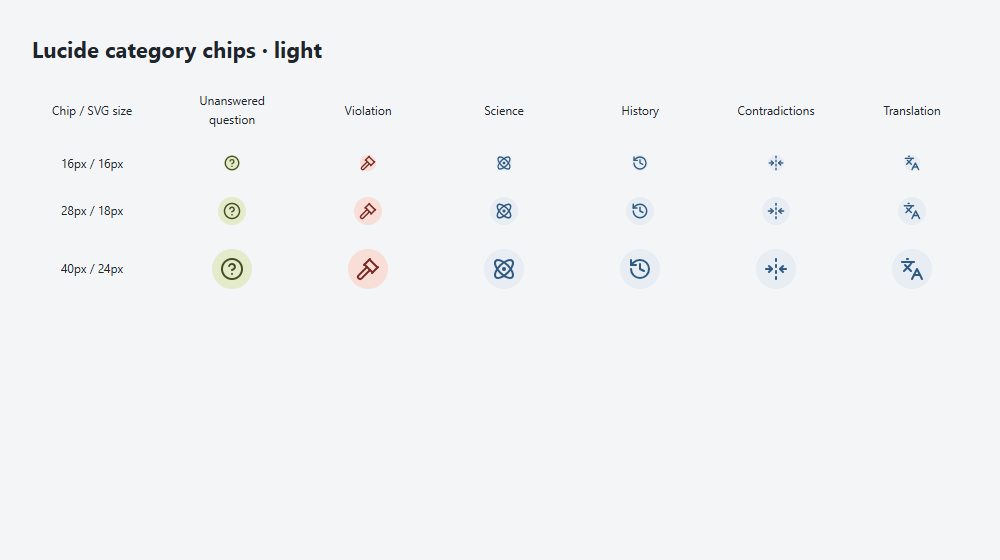
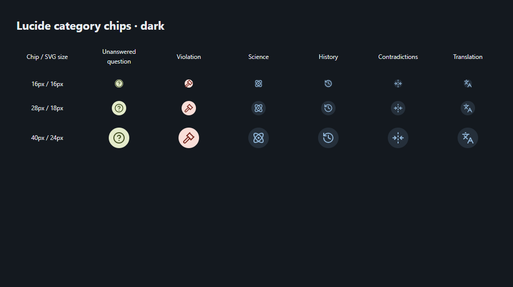
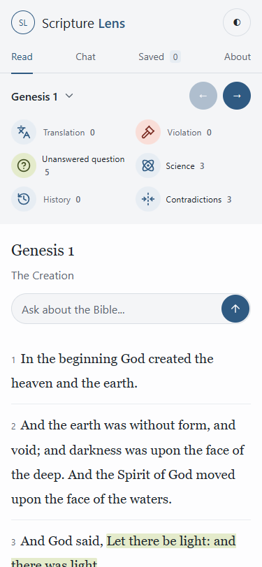
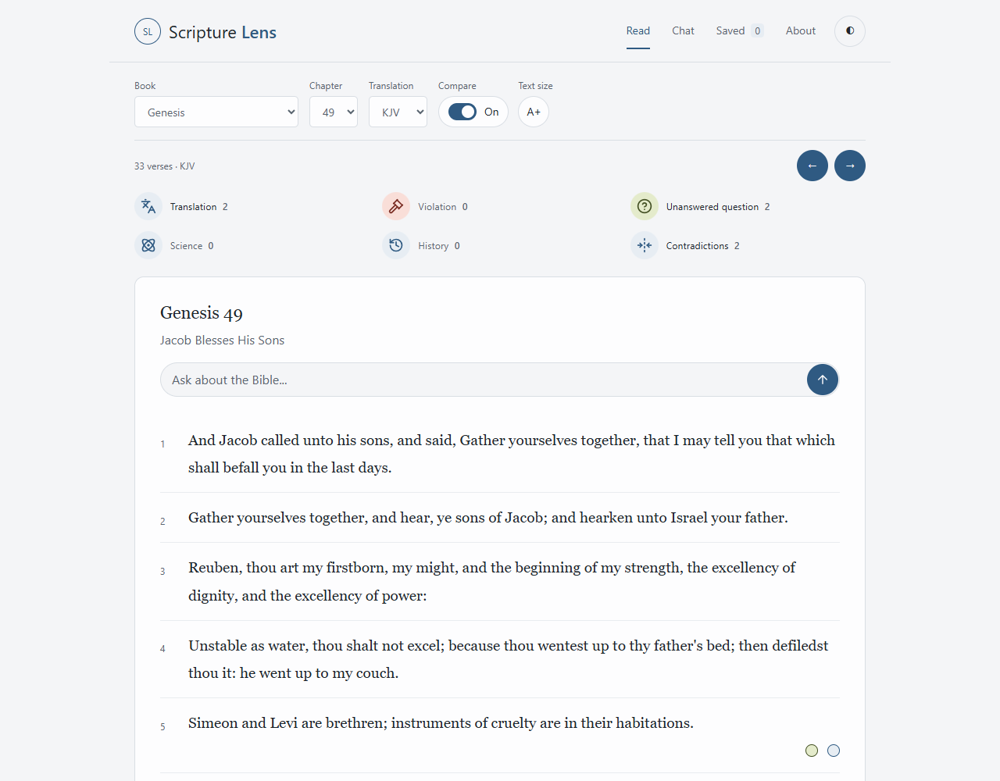
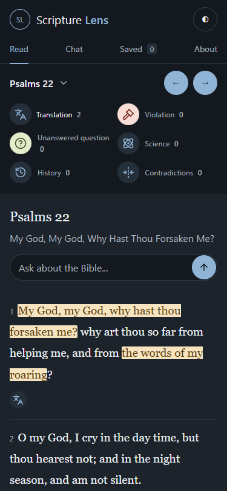
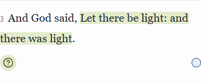

# Scripture Lens icons — 2026-10-13

Completed as a follow-up to the published UI refresh and cleanup. The interrupted run had uncommitted local edits; those agreed assets were retained, verified and completed rather than re-researched. No annotation data, content, red-letter colors, witness meanings, Chat engine or Claude drafts were changed.

## Icon set and decisions

One set: [Lucide](https://lucide.dev/), outline inline SVG, shared viewBox 0 0 24 24, stroke-width 2 with round caps/joins. [ISC licence](https://lucide.dev/license) permits use and distribution; the complete upstream licence notice is embedded in reader.js and retained in the adjacent lucide-LICENSE.txt. SVG paths are unmodified upstream paths, with source details in icon-sources.json.

| Category | Lucide icon |
|---|---|
| Unanswered question (Q) | circle-question-mark |
| Violation (V) | gavel |
| Science (S) | atom |
| History (H; stored mode history) | history |
| Contradictions (C; stored mode contradictions) | fold-horizontal |
| Translation (T) | languages |

Gavel is the agreed Violation choice: Lucide's whistle has a mouthpiece but no visible lanyard loop. Fold Horizontal is the agreed closest clash glyph: two opposing arrows point inward toward a central dashed line. It is not a swap icon. No icon was hand-drawn or combined with another set. Translation uses the letter-and-character glyph, never a chat bubble.

Main verse chips are 28px circles with decorative SVGs. The filter legend uses 36px icon circles with visible category names and unique-record counts. Compact citation category badges are 36px circles with 16px SVGs. Buttons retain meaningful aria-labels and tooltips; SVGs are aria-hidden and not focusable. T cards and citations retain their witness lead-ins (Hebrew, Septuagint, Hebrew and Septuagint, Greek New Testament).

Owner browser-comment correction: supporting-context markers are 16px symbol-free circles on the right, with enlarged pointer hit areas, labels/tooltips and the existing on/off handler. Key icons stay on the left. The Ask placeholder and accessible name now say "Ask about the Bible". Existing global retrieval/Whole Bible Chat behavior and selected-passage follow-up context are unchanged; the misleading chapter-scoped label was removed.

## Contrast

Ratios measured from rendered icon foreground/background colors using WCAG sRGB relative luminance. Q remains exactly #435023 on #e4ebcb; V remains exactly #792b22 on #f9ded8. S/H/C/T use the unchanged --green foreground on --soft background.

| Chips | Light | Dark |
|---|---:|---:|
| Q | 7.07:1 | 7.07:1 |
| V | 7.55:1 | 7.55:1 |
| S, H, C, T | 6.13:1 | 6.25:1 |

All exceed 3:1, and also 4.5:1 for icon-only cues. No icon contrast exception. Existing red-letter highlight contrast limits documented in the earlier UI refresh are unchanged.

## Verification

npm run check and npm run build passed. Existing rendering assertions were updated from literal letters to SVG identities; T witness, independent tag toggles, source metadata, red-letter boundaries, Questions mode and global Chat retrieval checks still pass. The 18 build Chat reliability cases are fixtures, not live generated-answer tests.

Actual built Worker rendered in headless Microsoft Edge. Genesis 1, Genesis 49 and Psalms 22 checked at 375×812 and 1280×1000 in light and dark (12 views), with no page errors or horizontal overflow. First verses remain fully visible on the phone. Checked 28px key chips, 16px right-side context markers, labelled 36px filters, hover names, keyboard filter focus/Space toggling, individual summaries, context pointers, settings sheet, and T witness lead-ins. Global Ask label verified in every view. All six distinct silhouettes visually reviewed at 16, 28 and 40px in both themes, including the compact 16px glyph use.

Screenshots and machine-readable browser results are in [ui-icons-2026-10-13](ui-icons-2026-10-13/).

