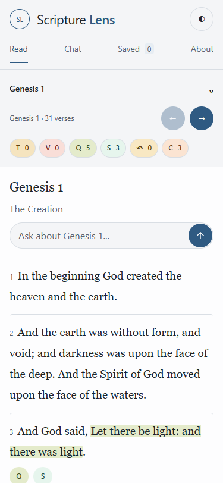
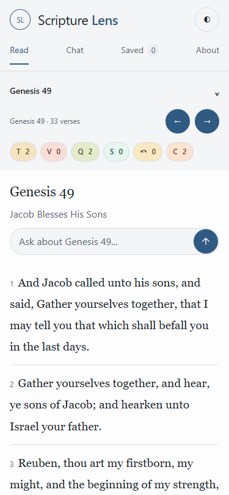
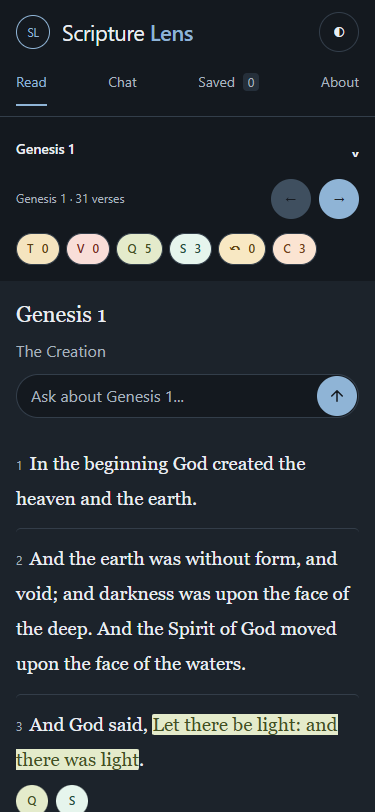
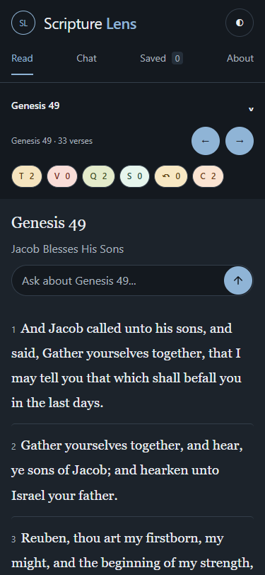
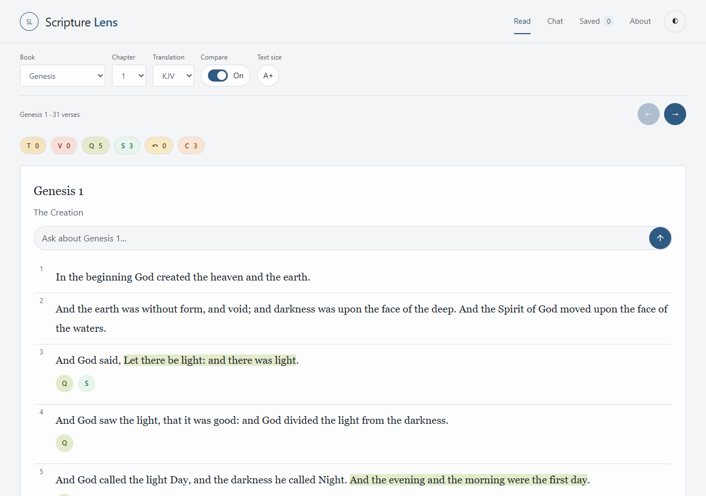
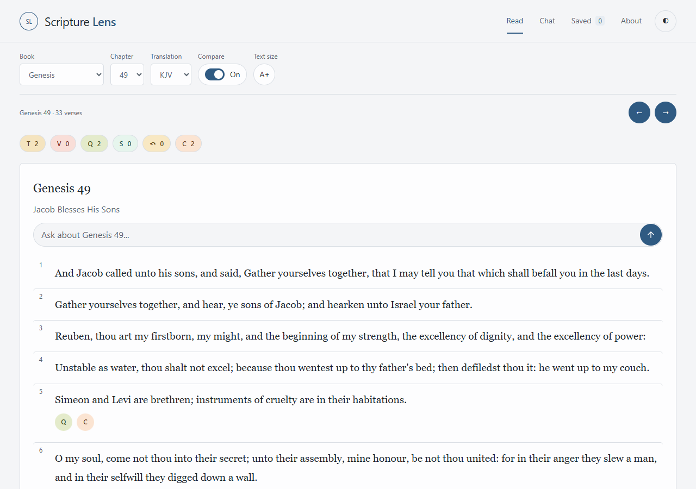
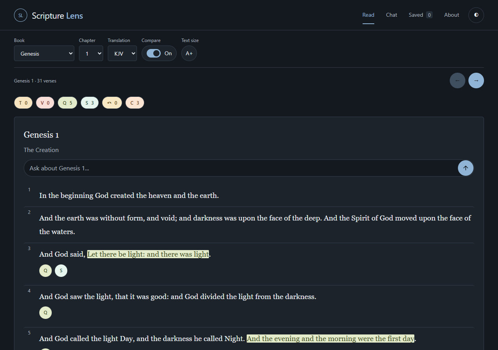
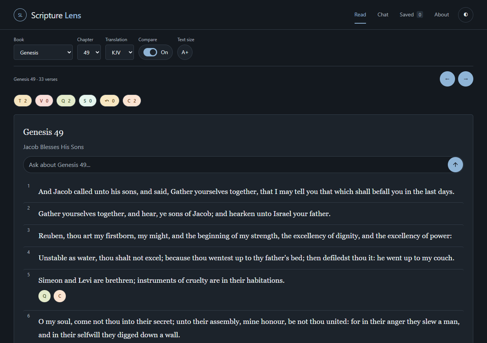
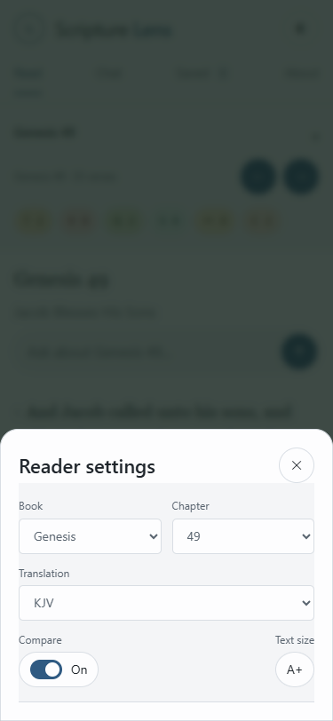
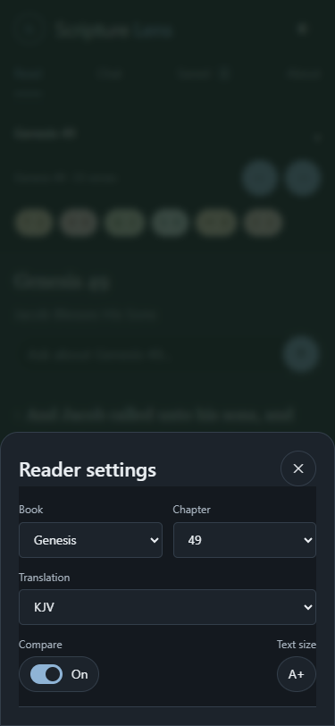

# Scripture Lens UI refresh — 2026-10-13

Owner-approved presentation refresh. The exact blue-gray default light/dark tokens supersede the cream/green and interim green defaults. No listed old default token remains in src/. Existing alternate palette blocks are retained. Red-letter colors, T/V/Q and other tag fills/ink, summary tints, content, evidence, chapter names, tag meanings and witness lead-ins are unchanged. Dark ordinary text on pale verse targets now uses the matching category ink for readability; red words retain their original red color.

## Presentation

Removed the visible Read heading/description; screen readers retain them. At 600px and under, a compact chapter picker opens a modal sheet containing the same Book, Chapter, Translation, Compare and A+ controls, with their existing handlers. Desktop retains one aligned 40px control row. The reading card is edge to edge on phones with 16px side padding and inline verse numbers. Chapter title, unchanged chapter-name subtitle and a full-width one-line 44px question composer are stacked in order. Chapter title is Georgia 22px; subtitle uses the approved 16px UI body step. All 1,189 names fit at most three lines at 375px. Buttons and chips use circles/pills, and 40px arrows appear above and below the chapter.

Category filters show unique record counts, retain accessible names/tooltips, and filter category visibility without changing independent verse-summary toggles, record selections or witness labels. Verse chips stay together at the left in T, V, Q, S, History, Contradictions order. Zero-count filters are disabled and retain full text contrast. V currently has no published record; its production filter color and independent renderer fixture were checked.

Shared type scale: 12/14/16/19/22/28px, plus 40px for a hero if present. Interface uses system sans; scripture and chapter titles use Georgia. Weights are 400/600, UI line-height 1.6 and scripture 1.85. A+ remains persistent and scales scripture/all typography; 12px captions have a minimum even at the 90% setting. Two existing test assertions were updated for the new root baseline/header arrangement; no semantic checks were weakened.

## Contrast

WCAG sRGB relative luminance, shown as panel and page background independently.

| Theme | Text | Panel | Background |
|---|---|---:|---:|
| Light | body | 15.21:1 | 14.18:1 |
| Light | muted | 5.85:1 | 5.45:1 |
| Light | primary | 7.11:1 | 6.63:1 |
| Light | red | 6.34:1 | 5.90:1 |
| Dark | body | 13.60:1 | 15.15:1 |
| Dark | muted | 7.45:1 | 8.30:1 |
| Dark | primary | 7.30:1 | 8.13:1 |
| Dark | red | 7.37:1 | 8.22:1 |

Body/muted pass 4.5:1 in both themes. Primary passes 7:1 except light primary on the page background: **6.63:1**, below the requested 7:1. The exact owner-supplied palette is retained; links still pass 4.5:1. Compare On/Off text uses body ink. Input placeholders use muted ink at full opacity.

T/V/Q and the other category chips pass 4.5:1 in both themes, against their unchanged fills: T 7.62:1; V 7.55:1; Q 7.07:1; S 8.60:1; History 7.28:1; Contradictions 7.25:1; Context 7.67:1. Rendered browser styles confirmed the exact T/V/Q foreground/background values at full opacity.

Red letters pass 4.5:1 on the new panel/page backgrounds in both themes. **Below 4.5:1:** unchanged dark red letters on pale targeted verse highlights: T 1.71:1; V 1.69:1; Q 1.75:1; S 1.91:1; History 1.77:1; Contradictions 1.75:1; Context 1.82:1. Light red letters on these highlights pass. Red-letter colors remain #b32925 / #ff9290 as instructed.

## Verification

npm run check and npm run build passed. Evidence/data/worker/Chat/citation/red-letter source files match the pre-refresh Git versions after Git line-ending normalization (working-copy hashes in adjacent contrast.json). No research/claude-drafts/ file was edited. The documentation pointer commit is retained.

Local headless Microsoft Edge rendered the actual built Worker; these are browser screenshots, not mockups. Eight requested views passed: Genesis 1 and 49 at 375×812 and 1280×900, light and dark. No page errors or horizontal overflow. At 375px the whole first verse ends at 528.06px (Genesis 1) and 598.34px (Genesis 49), without scrolling. Composer width equals the chapter header width, height 44px, placed below the subtitle. Filters hide/show their category; independent verse toggles open/close panels; T lead-ins remain; settings sheet/translation/compare/A+ controls work; top and bottom arrows navigate. Scripture changes from 19px to 20.9px at 110%, and 17.1px at 90%, with captions never below 12px. All 1,189 subtitles were measured at phone width. Chat submission logic and hosted AI behavior were not changed; the 18 build reliability cases are fixtures, not live generated-answer tests.

## Screenshots

### Genesis 1, 375px, light

### Genesis 49, 375px, light

### Genesis 1, 375px, dark

### Genesis 49, 375px, dark

### Genesis 1, 1280px, light

### Genesis 49, 1280px, light

### Genesis 1, 1280px, dark

### Genesis 49, 1280px, dark

### Mobile settings sheet

